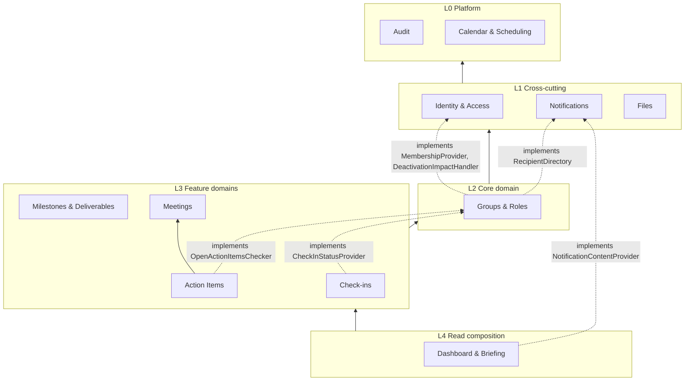
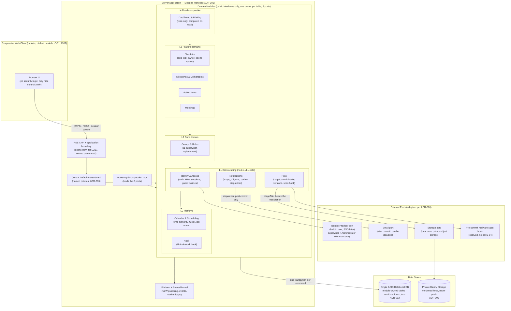

# FYP Supervision Tracker — Architecture

**Deliverable:** 3 (Architectural Context for AI-Assisted Development)
**Status:** Accepted by the project team, 2026-11-14 · **Revision 5**, 2026-11-18 (ADR-006 technology stack accepted; TD-11 to TD-13 from the final architecture review; all §9.5 items closed) · Revision 4, 2026-11-18 (aligned with the PRD final revision: open questions OQ-01, OQ-05 to OQ-13 resolved by team decisions TD-01 to TD-10 under client-delegated authority; G-19 and G-20 closed; no change to style, modules, ports or ADR decisions; see Section 12) · Revision 3 (architecture refinement: gaps G-1, G-2, G-6, G-7, G-8, G-9, G-10, G-11, G-13, G-15, G-17 resolved by human decision; see Section 12). Revision 2 addressed peer-review Issues 1–6.
**Inputs:** [`PRD_Final_FYP_Supervision_Tracker_Deliverable3.md`](PRD_Final_FYP_Supervision_Tracker_Deliverable3.md) (validated PRD, including TA-1 and TA-2) · the ASR analysis (Section 3) · ADR-001 to ADR-005 (Section 11)
**Companion file:** `AGENTS.md` gives the operational rules an AI coding agent must follow. This document (`ARCHITECTURE.md`) explains the architecture and why it was chosen.

> **How to read this document.** Sections 1–4 explain *why*. Sections 5–8 explain *what goes where* and are binding for implementation. Section 9 lists the constraints and open values the code must not hard-code. Module, entity, interface and event names are **indicative**: the meaning and ownership are binding, but exact class names, signatures and schemas are left to implementation. **The module design here is technology-neutral; the products that implement it are named in [ADR-006](ADR/ADR-006-technology-stack.md) (accepted):** Django + Django REST Framework, PostgreSQL, React + TypeScript + Vite + Tailwind CSS, django-allauth, a database-backed worker, Docker Compose and GitHub Actions. Adding any further technology needs human approval (AGENTS.md §10).

---

## 1. System Overview

### 1.1 Product intent

The FYP Supervision Tracker helps supervisors oversee Final Year Project Groups. It gives them an early-warning view of Groups that need attention and a dependable supervision history, using a lightweight weekly reporting routine, so that routine monitoring takes about two minutes a day (PRD §1, §3).

It covers six areas:
- the weekly **Check-in**: Individual contributions, one Consolidated report, deliberate audited locks (TA-1);
- **Milestones, Deliverables and Action items**, each with review decisions and extensions;
- **Meetings**, with notes, feedback and comments;
- a **Dashboard** showing Group status and two inactivity counters, plus the **Monday Morning Briefing**;
- **notifications**: urgent, Digest, in-app and email;
- **role continuity**: replacing an unavailable Representative or supervisor without losing pending work (TA-2).

### 1.2 Scope boundaries

| In scope (core build) | Out of scope |
|---|---|
| FR-01 to FR-16, NFR-01 to NFR-04, BR-01 to BR-32 | PRD Non-Goals: AI summaries, GitHub tracking, chat bots, email-reply parsing, QR Check-ins, gamification |
| A responsive web client for desktop, tablet and mobile (C-01, C-02) | Native mobile apps |
| Built-in login with mandatory supervisor and Administrator MFA (with recovery, BR-33), behind a port that can take SSO later (ADR-003) | Automatic detection of unavailability (Assumption 6) |
| In-app notifications, plus optional email through a port (ADR-004) | Deferred items D-01 to D-05 (Section 9.3). The architecture leaves room for each, but none is built. |
| File and HTTPS-URL intake with private storage (ADR-005) | |

### 1.3 Shape of the system

The system has three parts:
1. A **responsive web client** running in the browser.
2. A **REST API** served by **one server application**. The application is a **modular monolith** of 11 domain modules (ADR-001), plus a small amount of non-module code (shared kernel, platform plumbing, composition root, API / application boundary; Section 5.4). Every request passes through a **central deny-by-default authorization guard** (ADR-003).
3. One **ACID relational database** for all structured data (ADR-002) and **private binary storage** for uploaded files (ADR-005).

External services sit behind ports: **Identity Provider**, **Email** and **Storage**. The **pre-commit malware-scan hook** is a reserved extension point for later.

---

## 2. Architectural Goals and Drivers

### 2.1 Product goals that shape the architecture

| Goal | What the architecture must provide | Main mechanism |
|---|---|---|
| **G-1** Status and two counters on one Dashboard | Fast, correct overview across all of a supervisor's Groups | Values computed on read with indexed, set-based queries (ADR-002 §6); Dashboard & Briefing module |
| **G-2** Standard Check-ins with defined, audited locks | Exactly one lock, from one of three triggers; never caused by viewing a page | Atomic conditional update + unique lock constraint; lock state derived from time (ADR-002 §1, ADR-004 §2); cycles opened by a scheduled job, never by a read |
| **G-3** Milestones, Deliverables, reviews, extensions | Immutable versions; original, revised and effective deadlines | Append-only history (ADR-002 §3); Calendar deadline history (ADR-004 §1); Files versions (ADR-005) |
| **G-4** Accountable Action items | Single assignee, decisions where the first valid one wins, overdue calculation | Version-checked decisions; Calendar overdue rules |
| **G-5** Meeting history | Notes, comments and Action items kept and linked | Meetings module; audited edits |
| **G-6** Monday Morning Briefing | Always current, and tolerant of one category failing | Assembled on demand, one category at a time, plus a scheduled Monday job (ADR-004 §5) |
| **G-7** Role and Group access, plus an audit history | 100% denial of unauthorized access; audit committed with every change | Central guard (ADR-003); Unit-of-Work audit hook (ADR-002 §4) |
| **G-8** Continuity across replacements | Never zero supervisors; no lost drafts or approvals; deadlines untouched | Group row lock + version numbers (ADR-002 §2); approvals held in a Group-level queue; Check-in state read through ◆ `CheckInStatusProvider` |

### 2.2 Quality attributes (NFRs)

| NFR | Driver | Architectural response |
|---|---|---|
| **NFR-01** Performance: 95% of Dashboard and Group-detail loads ≤ 2 s; saves ≤ 3 s | ASR-8 | Read paths use indexed, set-based queries (no query per Group). Transactions are short. No external call is made inside a transaction (ADR-002 §7); file content is staged before the transaction (Section 6.3). Email is sent after commit (ADR-004 §4). Caching is allowed only within a single request (ADR-003). |
| **NFR-02** Usability: attention Groups found within 30 s; daily monitoring within 2 min | ASR-8 | One Dashboard query interface. The Briefing aggregates all FR-15 categories. Responsive client (C-01). |
| **NFR-03** Security: 100% denial in scripted access tests; supervisor and Administrator MFA | ASR-3, ASR-7 | One deny-by-default guard on every request, with named policies, re-checked inside write transactions (by the owning module, or by the application boundary for L0/L1-owned commands, Section 6.2). Downloads go through the guard. MFA is required for supervisors and Administrators (ADR-003 Amendment 1). |
| **NFR-04** Reliability: records always saved; locks and replacements all-or-nothing with their audit entry; saves work with email off | ASR-1, ASR-2, ASR-4, ASR-6 | One ACID transaction per command. The audit entry and outbox row are written in the same commit. Email is isolated behind the outbox. |

### 2.3 Constraints that drive the architecture

| Constraint | Architectural response |
|---|---|
| **C-01** Responsive on desktop, tablet and mobile | One responsive web client; no device-specific back end |
| **C-02** Latest two versions of Chrome, Edge, Firefox and Safari | Client uses only standard web features supported by those browsers |
| **C-03** No stack or provider fixed | Ports for Identity Provider, Email and Storage. Products are named in ADR-006 (accepted); adapters remain swappable. |
| **C-04** All deadlines in the Official academic time zone | Calendar & Scheduling is the single time authority with an injectable Clock (ADR-004 §1) |
| **C-05** Acceptance thresholds agreed with the client | Configurable values; the controllable Clock makes boundary tests repeatable |
| **C-06** Confirmed rules change only through approved changes | Each rule has one home: lock rules in Check-ins, roles in Groups & Roles, dates in Calendar & Scheduling, permissions in Identity & Access policies, recipient rules in Notifications |

---

## 3. Architecturally Significant Requirements (ASRs)

The architecturally significant requirements, with their PRD sources and architectural impact:

| ASR | Requirement | PRD sources | Architectural impact | Decided in |
|---|---|---|---|---|
| **ASR-1** | Check-in lock: exactly one winner among Representative submission, the deadline and supervisor Start review; lock, missing records and audit saved all-or-nothing | BR-02, BR-03, BR-04, BR-06, BR-28, FR-05, NFR-04; EC-21, EC-22; AC-05d, AC-05f, AC-05g | Check-ins is the only owner of lock state. Lock = one atomic conditional update ("unlocked AND now < effective deadline") + a unique constraint. Lock state is derived from time, so the deadline wins at the deadline instant. Cycles are opened by a scheduled job (`openWeeklyCycle`). Notifications are sent after commit. | ADR-002, ADR-004 |
| **ASR-2** | Role replacement: always ≥ 1 Assigned supervisor; Representative replacement vs. report submission, first save wins; stale actions refused; deadlines untouched | FR-01, FR-04, FR-16, BR-14, BR-21, BR-30, BR-31, BR-32; EC-26, EC-28, EC-30, EC-33; AC-04d–g, AC-16a, AC-16b, AC-16f | Multi-row invariants are checked inside one transaction under a Group row lock. Roles and drafts carry version numbers. Approvals sit in a Group-level queue. Role data is kept separate from scheduling data; Groups & Roles reads Check-in deadline and report status only through ◆ `CheckInStatusProvider`. | ADR-001, ADR-002 |
| **ASR-3** | Authorization by role, Group membership, record state and time, with immediate revocation; supervisor and Administrator MFA with recovery | NFR-03, FR-02, BR-21, BR-28.1, BR-30.2–3, BR-30.11, BR-31.3, BR-31.10, BR-33, Assumption 7; AC-01f, AC-02a–e, AC-05e, AC-16b | One central deny-by-default guard with named policies. Server-side sessions hold identity only. Policies are re-checked inside write transactions; for commands owned by L0/L1 modules the application boundary performs the re-check (Section 6.2). | ADR-003 |
| **ASR-4** | Immutable, append-only history, with audit committed alongside each change | BR-05, BR-06, BR-12, BR-15, BR-20, BR-25, BR-27, BR-29, BR-30.8, FR-02, FR-05, FR-10; AC-02c, AC-05c, AC-05h, AC-05i | Versions, annotations and linked records instead of updates; records are cancelled, never deleted. A shared Unit-of-Work audit hook writes in the same transaction. | ADR-002 |
| **ASR-5** | Time as an input: Official time zone, Blackouts, counters, time-triggered events | C-04, BR-07, BR-08, BR-10–BR-14, BR-16, BR-19, FR-06, FR-08, FR-15; EC-05, EC-06, EC-19, EC-20, EC-32; AC-06c, AC-06d, AC-06f, AC-08a, AC-15d, AC-16d | One Calendar & Scheduling authority with an injectable Clock. Derived values are computed on read. Durable, idempotent, cancellable jobs. | ADR-004 |
| **ASR-6** | External I/O decoupled; partial failures tolerated | NFR-04, FR-14, FR-15, BR-22, BR-23; EC-14, EC-15; AC-14a, AC-14b, AC-15c | Transactional outbox + Email port. In-app notifications written in the same commit. Callers supply target facts; Notifications alone applies BR-22 recipient rules (Section 6.2 rule 7). Briefing categories load independently. | ADR-004 |
| **ASR-7** | File and URL intake and storage boundary | BR-09, BR-15, BR-26, FR-10, FR-12; EC-16, EC-17; AC-10d, AC-10e, AC-10f; CFG-10 to CFG-12 (TD-04), D-04 | Server-side intake checks (extension, actual type, size; HTTPS format only). Two-step intake: `stageFile` (checks + storage write, before the transaction) then `commitFile` (version record, inside the transaction). Private storage behind a port. Versioned keys. Downloads guarded. Reserved scan hook. Orphan cleanup for staged files never committed. | ADR-005 |
| **ASR-8** | Responsiveness on multiple devices | NFR-01, NFR-02, C-01, C-02, FR-07, FR-15; AC-07, AC-07b, AC-15a; TP-01, TP-02 (TD-01) | Efficient set-based read paths for Dashboard and Briefing. Responsive client. Measured under test profile TP-01 (PRD §7.1); a cache needs a superseding ADR. | ADR-001, ADR-002, ADR-004 |

---

## 4. Selected Architectural Style and Rationale

### 4.1 Decision

The system is a **modular monolith with 11 domain modules**: one deployable server application and one relational database. Modules talk only through explicit public interfaces, and each table is owned by exactly one module (ADR-001). A responsive web client uses the server through a REST API.

### 4.2 Why this style

1. **Atomicity without distributed transactions.** The lock (ASR-1), the "add new supervisor + remove old supervisor + check ≥ 1 remains" replacement (ASR-2) and the matching audit entry (ASR-4) each commit in **one local ACID transaction**.
2. **Every rule has one home (C-06).** Lock rules, role rules, date rules and permission rules each live in exactly one module. Rule changes can then be controlled, and an AI agent gets concrete boundaries to respect.
3. **Shared capabilities exist once.** Calendar & Scheduling, Audit, Notifications and Identity & Access are modules that every feature reuses, so no feature has its own date arithmetic, audit writes, email calls or permission checks.
4. **Right-sized.** One institution's FYP cohort needs neither independent scaling nor independent deployment. One deployable is achievable for a small team in one semester.

### 4.3 Alternatives rejected

| Alternative | Why rejected |
|---|---|
| **Microservices** (a database per service, communication over HTTP or messages) | ASR-1 and ASR-2 are invariants that span several records ("exactly one lock + its audit entry", "never zero supervisors"). Across services they would need sagas or two-phase commit, and neither gives those guarantees simply. The style also adds deployment, network-failure and observability costs that no ASR justifies (no requirement needs independent scaling; D-05 has no target). It would also make the system harder for the team and the AI agent to build correctly. |
| **Layered monolith** (UI → controllers → services → data access, organized by technical layer) | It has the same transactional strength, but each business rule ends up spread across generic "service" classes, and any service can reach any table. Lock, replacement and date rules would be duplicated, which breaks C-06 and invites ad-hoc date math (against ASR-5). It also gives AGENTS.md no meaningful boundaries to enforce, so architectural drift is likely. |

**Accepted costs (ADR-001):** module boundaries are not enforced by a network, so they must be enforced by dependency rules, one top-level package per module, and architecture or dependency tests. The application scales and fails as one unit, which is acceptable at this scale. In-process events are lost on a crash, so anything that must survive a crash goes through the database outbox or job table (Section 6.4).

---

## 5. Major Components and Modules

### 5.1 Module dependency layers

Dependencies go **downward only**. Compile-time cycles between modules are not allowed. **Modules in the same layer never depend on each other**, with the single documented L3 exception below (in particular, no L1 module calls another L1 module). Where a lower module needs data or behaviour owned by a higher one, the lower module **declares a port** and the higher module **implements** it (dependency inversion). There are **exactly six ports**, each marked ◆ below; no other upward call is allowed.

| Layer | Modules | May depend on |
|---|---|---|
| **L0 — Platform** | Audit · Calendar & Scheduling | Nothing in the business domain |
| **L1 — Cross-cutting services** | Identity & Access · Notifications · Files | L0 only (never each other). Ports ◆ `MembershipProvider` and ◆ `DeactivationImpactHandler` (declared by Identity & Access) and ◆ `RecipientDirectory` (declared by Notifications) are implemented by Groups & Roles. |
| **L2 — Core domain** | Groups & Roles | L0, L1. It declares two ports implemented by L3 modules: ◆ `OpenActionItemsChecker` (implemented by Action Items, for the BR-21 removal check) and ◆ `CheckInStatusProvider` (implemented by Check-ins, for the BR-30 Representative-replacement rules). Groups & Roles **never** calls Action Items or Check-ins directly. |
| **L3 — Feature domains** | Check-ins · Milestones & Deliverables · Action Items · Meetings | L0, L1, L2. Within L3, only the one documented dependency is allowed: Action Items → Meetings (next-Meeting query, BR-17). |
| **L4 — Read composition** | Dashboard & Briefing | Query interfaces of L0–L3. It implements ◆ `NotificationContentProvider` (declared by Notifications) to build Briefing and Handover-summary content. |

**The six ports:**

| Port | Declared by | Implemented by | Purpose |
|---|---|---|---|
| ◆ `MembershipProvider` | Identity & Access (L1) | Groups & Roles (L2) | Current Group membership and roles for policy evaluation |
| ◆ `DeactivationImpactHandler` | Identity & Access (L1) | Groups & Roles (L2) | Group side of account deactivation, including its BR-22 notifications (Section 6.6) |
| ◆ `RecipientDirectory` | Notifications (L1) | Groups & Roles (L2) | Role-based recipients, Administrators and contact details |
| ◆ `NotificationContentProvider` | Notifications (L1) | Dashboard & Briefing (L4) | Briefing and Handover-summary content |
| ◆ `OpenActionItemsChecker` | Groups & Roles (L2) | Action Items (L3) | BR-21 removal precondition |
| ◆ `CheckInStatusProvider` | Groups & Roles (L2) | Check-ins (L3) | Read-only current-cycle deadline and report status for BR-30 |



Solid arrows are allowed compile-time dependencies (downward). Dotted arrows show a higher module implementing a port declared by a lower module; the lower module sees only the port, never the implementing module. Port implementations are bound in the composition root (Section 5.4).

### 5.2 Module catalogue

For each module: **responsibility**, **owned entities** (logical tables; exact schema decided during implementation), and **boundaries** (what it must never do or what it never owns).

#### 1. Identity & Access (L1) — ADR-003

- **Responsibility:**
  - user accounts and invitations, and optional self-registration (FR-01);
  - built-in authentication behind the **Identity Provider port**, with **MFA mandatory for the supervisor and Administrator roles** (ADR-003 Amendment 1, TD-11);
  - MFA recovery and password reset (BR-33): single-use recovery codes, `resetMfa(userId)` by an Administrator for another user (never self; audited), an operator management command used only when no other Administrator can act, emailed single-use password-reset links, and the CFG-16 failed-attempt rule;
  - the **last-active-Administrator guard**: an Administrator account cannot be deactivated if no other active Administrator would remain (BR-33(f)); the check locks the active Administrator `UserAccount` rows in ascending ID order;
  - server-side sessions; account activation and deactivation;
  - the **central deny-by-default policy guard**: named policies such as `checkin.startReview`, `group.replaceRepresentative`, `group.replaceSupervisor`, `audit.read` and `file.download`;
  - account-level queries used by other modules: `contactFor(userId)` (email address and display name for notification delivery) and `administrators()` (active Administrator accounts, for BR-16 / BR-22 escalation);
  - the account row lock `lockUserAccount(userId)`, which joins the caller's Unit of Work and is used to serialize eligibility checks against deactivation (Section 6.6).
- **Owns:** `UserAccount` (system role: Administrator, Supervisor or Student; status: active or deactivated), `Credential`, `MfaEnrolment` (including hashed single-use recovery codes), `Session`, `Invitation`, `SecuritySettings` (password, failed-attempt and session rules; seeded from PRD CFG-15 to CFG-17, TD-05; may be made stricter, never weaker than NIST SP 800-63B-4).
- **Boundaries:**
  - Does **not** own Group membership or Group roles. It reads them through the ◆ `MembershipProvider` port that Groups & Roles implements.
  - Does **not** query feature tables. Record state (for example "Check-in unlocked") is **passed in by the caller** as policy context.
  - Sessions carry identity only, never permissions.
  - **Never calls Notifications or Files** (no L1 → L1 dependency). Notifications needed by a deactivation are enqueued by Groups & Roles inside ◆ `DeactivationImpactHandler`.
  - Deactivating an account is one atomic Unit of Work. It locks the account and, through ◆ `DeactivationImpactHandler`, every affected Group; it refuses with the list of blocking Groups if any would lose its last supervisor; and only then deactivates the account and ends its sessions (Section 6.6).

#### 2. Groups & Roles (L2) — FR-01, FR-16, BR-21, BR-30, BR-31, BR-32

- **Responsibility:**
  - Groups (setup → active), membership (current and Former), co-supervisor assignment, Administrator override;
  - the **initial Representative appointment** (BR-30.11, TD-12): `appointRepresentative` is available only while the Group is in setup and only to an Assigned supervisor; `activateGroup` refuses unless the appointed Representative is still eligible (current member, active account, checked with a shared `lockUserAccount` before the Group lock). Vacancy handling applies only to active Groups;
  - the **Representative role**: hand-over, majority confirmation, supervisor replacement, vacancy. The time and record-state conditions of BR-30.2 and BR-30.3 (before / after the Check-in deadline; whether the Consolidated report is already submitted) are read through ◆ `CheckInStatusProvider` inside the transaction and compared with `Calendar.now()`;
  - **majority confirmation rules (BR-30.2, TD-10)**, applied inside the `confirmRepresentativeByMajority` Unit of Work under the Group row lock: at most one active confirmation per active current member (a new one supersedes, withdrawal allowed until the majority is reached); confirmations are bound to the current cycle (from ◆ `CheckInStatusProvider`) and are counted only while `Calendar.now()` is before its deadline, so they never carry across cycles; only confirmations of current members with active accounts are counted, against current membership; the replacement is applied when the saved confirmation creates the majority (no pending replacement) — a membership change never applies it by itself; outstanding confirmations are closed (status change, never deleted) whenever the Representative assignment changes, including a vacancy;
  - the **Assigned-supervisor role**: atomic "Replace supervisor";
  - the **≥ 1 Assigned supervisor invariant**;
  - eligibility rules for candidates;
  - the BR-21 removal precondition (no non-Completed Action items owned by the student), checked through its own port ◆ `OpenActionItemsChecker`;
  - the Group side of account deactivation (Section 6.6), through ◆ `DeactivationImpactHandler`: locking affected Groups, checking supervisor coverage, applying the consequences for Groups, **and enqueuing the resulting BR-22 notifications** (supervisor change, Representative vacancy, and the deactivated assignee's open Action items read through ◆ `OpenActionItemsChecker`, BR-21/TD-07) in the same Unit of Work;
  - the Group row lock for other modules: `lockGroupShared(groupId)` (used by Consolidated report submission, Section 6.7).
- **Owns:** `Group` (with **version number**, used as the row-lock target), `GroupMembership` (history, including Former members), `SupervisorAssignment` (history), `RepresentativeAssignment` (history, vacancy, **version number**, reason), `RepresentativeConfirmation` (confirmations for the majority path, BR-30.2(ii): member, candidate, cycle, time, status: active / withdrawn / superseded / closed; expiry at the cycle deadline is derived from time, not stored; rules below).
- **Boundaries:**
  - **Never** changes deadlines, Missed Check-ins, review timers, drafts or approvals (BR-32).
  - The Consolidated draft belongs to the Check-in, not to a person, so a replacement transfers nothing. It only changes who may act.
  - **Never depends on any L3 module.** It declares ◆ `OpenActionItemsChecker` (implemented by Action Items) and ◆ `CheckInStatusProvider` (implemented by Check-ins) and sees only those ports.
  - Implements ◆ `MembershipProvider`, ◆ `DeactivationImpactHandler` and ◆ `RecipientDirectory`. Its `RecipientDirectory` implementation uses Identity & Access's `contactFor` and `administrators()` to supply contact details and Administrator recipients.

#### 3. Check-ins (L3) — FR-03 to FR-06, BR-01 to BR-06, BR-28, BR-29

- **Responsibility:**
  - weekly Check-in cycles, **opened proactively** by `openWeeklyCycle(groupId, period)`, run by the scheduled `cycle-opening` job (Section 6.8);
  - Individual contributions (explicit responses, BR-01);
  - the Consolidated draft and report;
  - the **lock**: one owner, three triggers, Start review with a confirmation step;
  - missing and late contributions; corrections; "review started in error" annotations;
  - Missed Check-ins and their annotations (including "Representative role vacant at deadline");
  - Check-in reminder jobs;
  - implements ◆ `CheckInStatusProvider` (declared by Groups & Roles): `currentCycleStatus(groupId)` returns, read-only, the current cycle ID (or none), its deadline reference and effective deadline, whether a `ConsolidatedReport` exists, and the lock trigger and time if locked. The implementation never writes, never materializes a deadline outcome, and joins the caller's Unit of Work.
- **Owns:** `CheckInCycle` (Group, period, deadline reference, **version**; **unique per Group and period**), `IndividualContribution`, `ContributionCorrection` (student comment / supervisor corrected version, linked to the original), `CheckInLock` (**unique per cycle**: trigger `SUBMISSION` / `START_REVIEW` / `DEADLINE`, actor, lock time), `MissingContribution`, `LateContribution` (linked to its missing record), `ConsolidatedDraft` (+ draft history, **version**), `ConsolidatedReport` (**unique per cycle**, `isLate` flag), `MissedCheckIn`, `CheckInAnnotation`.
- **Boundaries:**
  - The **only** module that can create a lock, following the arbitration rules in Section 6.5.
  - Opening, viewing or printing a page is a pure query and never changes state (BR-28.2). **A read never opens a cycle**: if no cycle is open yet, queries report "no open cycle".
  - Asks Groups & Roles who the current Representative is, and asks Calendar & Scheduling for the effective deadline and the current time. Does no date arithmetic itself.
  - Never reverses a lock, deletes a missing record or deletes a Missed Check-in.

#### 4. Milestones & Deliverables (L3) — FR-09, FR-10, BR-09, BR-15, BR-16, BR-20

- **Responsibility:**
  - the Administrator's Milestone template and per-Group customization;
  - Milestones; Deliverable submissions and versions; review decisions (approve, or reject with a mandatory reason and required revisions);
  - Milestone extension requests;
  - review-overdue and 3-day Administrator escalation jobs for its own reviews;
  - Milestone reminder jobs (PRD CFG-05: to all Group members, only while no valid Deliverable exists; resolved when they fire).
- **Owns:** `MilestoneTemplate`, `MilestoneTemplateItem`, `Milestone` (deadline reference, completion), `Deliverable`, `DeliverableVersion` (references a Files attachment version or a URL), `DeliverableReview` (**version-checked**, so the first valid decision wins), `MilestoneExtensionRequest`.
- **Boundaries:**
  - Binary content and URL checks are delegated to Files (`stageFile` before the transaction, `commitFile` inside it).
  - Deadline values (original, revised, effective) are stored by Calendar & Scheduling; this module stores only a reference.
  - Pending reviews belong to the **Group-level queue**: any current Assigned supervisor may decide.

#### 5. Action Items (L3) — FR-11, FR-12, BR-17, BR-18, BR-19, BR-27

- **Responsibility:**
  - Action items with a single assignee; default due dates (asks Meetings for the next Meeting start);
  - reassignment; the status machine (Open, Blocked, In Review, Completed);
  - evidence; review decisions; extension and deadline-change requests; supervisor-only reopen with a reason;
  - overdue, review-overdue and escalation jobs for its own items;
  - Action-item reminder jobs (PRD CFG-06: to the assignee current when the job fires, only while Open or Blocked);
  - reassignment of an item whose assignee's account is deactivated, by any Assigned supervisor, to a current member with an active account (BR-21, TD-07); account status comes from Identity & Access `accountStatus` and the "assignee deactivated" marker is computed on read, never stored.
- **Owns:** `ActionItem` (assignee, creator, status, **version**, deadline reference), `ActionItemTransition` (history), `ActionItemEvidence` (Files attachment or URL reference), `ActionItemReview`, `ActionItemExtensionRequest` / `DeadlineChangeRequest`, `ActionItemReopen`.
- **Boundaries:**
  - Fields are frozen while In Review (BR-17).
  - A due date, once set, never follows a rescheduled or cancelled Meeting; it changes only through an approved deadline change or extension (BR-17, BR-20, TD-06). `nextMeetingStart` is used only to compute the default at creation.
  - Never reassigns, cancels or closes items because an account was deactivated (TD-07).
  - **Implements** ◆ `OpenActionItemsChecker` (declared by Groups & Roles), answering "does user X own non-Completed Action items in Group G, and which ones?" for the BR-21 removal check. The implementation is read-only and joins the caller's Unit of Work.
  - Never decides Group status (Dashboard & Briefing composes it).

#### 6. Meetings (L3) — FR-13, BR-24, BR-31.9

- **Responsibility:**
  - creating, rescheduling and cancelling Meetings; attendees; supervisor notes and feedback (edits audited); student comments;
  - tells Calendar & Scheduling about every schedule change, inside its own Unit of Work, through `Calendar.onMeetingScheduleChanged(groupId, meetingId, start, cancelled)`, so that meeting-relative Check-in deadlines are handled (BR-07, TD-09). It passes facts only; it never chooses the driving Meeting or computes a deadline.
- **Owns:** `Meeting`, `MeetingAttendee`, `MeetingNote`, `MeetingComment`.
- **Boundaries:**
  - Students cannot edit or delete supervisor-authored records.
  - When a supervisor is replaced, Meetings stay scheduled; the replaced supervisor is only removed from the attendee list (BR-31.9).
  - Exposes `nextMeetingStart(groupId, after)` to Action Items. Action-item due dates **never** follow a rescheduled or cancelled Meeting (BR-17, TD-06), so Meetings never calls Action Items.

#### 7. Calendar & Scheduling (L0) — ADR-004; C-04, BR-07, BR-08, BR-11 to BR-14

- **Responsibility:** the **single time authority**:
  - the Official academic time zone; the Blackout calendar;
  - the global weekly deadline and Group overrides;
  - meeting-relative deadline rules (BR-07, TD-09): the Group's deadline setting (global weekly, Group override, meeting-relative; a change applies from the next cycle); the **driving Meeting** = earliest non-cancelled Meeting whose start falls within the cycle's period, chosen from the `MeetingDeadlineSource` facts supplied by Meetings; fallback to the global weekly deadline; recalculation on each Meeting change only for unfrozen deadlines and only if the result is in the future;
  - effective-deadline calculation and history (original, revised, effective);
  - calendar-date-boundary counter calculation; overdue-duration and review-countdown calculation, paused by Blackouts;
  - time-related configuration;
  - the **injectable Clock**;
  - the **durable job runner** (idempotency keys, cancel and reschedule).
- **Owns:** `CalendarSettings` (time zone, global deadline, **Group deadline setting** (mode and override), inactivity-threshold defaults and Group overrides, review-period defaults and overrides, reminder intervals, escalation delay), `BlackoutDate`, `MeetingDeadlineSource` (Meeting facts supplied by Meetings for the BR-07 rule: Group, meeting ID, start, cancelled; Calendar never reads Meetings' tables), `DeadlineRecord` + `DeadlineHistory` (append-only; **frozen** flag set by the owning module at lock or submission), `ScheduledJob` (idempotency key, due instant, handler type, status).
- **Boundaries:**
  - Provides **calculations over facts supplied by callers**. It does not own "last valid Check-in" or "last valid Deliverable"; those facts belong to Check-ins and Milestones & Deliverables.
  - The job runner calls **handlers registered by owning modules** through a handler interface, so Calendar never depends on feature modules.
  - **No other module does date arithmetic or reads the system clock directly.**
  - **Never imports Identity & Access.** Its user-initiated commands (`addBlackout`, `removeBlackout`, `updateSettings`) are authorized and re-checked by the **application boundary**, which opens the Unit of Work before calling them (Section 6.2 rule 4).

#### 8. Notifications (L1) — ADR-004; FR-14, BR-22, BR-23, OQ-05

- **Responsibility:**
  - in-app notifications (urgent and ordinary);
  - **recipient rules for every BR-22 event type** (the single home for them, C-06). Notifications decides who receives each event, using two inputs:
    - **target facts supplied by the caller** in the `enqueue(eventType, context)` payload: domain-specific user IDs that only the calling module knows, for example `assigneeId`, `previousAssigneeId`, `creatorId`, `attendeeIds`, `missingMemberIds`, `newRepresentativeId`, `previousRepresentativeId`, `newSupervisorId`, `replacedSupervisorId`;
    - **role-based recipients** it resolves itself through ◆ `RecipientDirectory` (all Group members, Assigned supervisors, current Representative, Administrators) together with contact details;
  - Digests (time, time zone and days chosen by the user; empty Digests skipped);
  - the email on/off preference (global and per user);
  - the **transactional outbox** and the **dispatcher**, which sends through the **Email port** with retry and backoff (at-least-once delivery with duplicate mitigation, Section 6.4);
  - the Digest duplicate rule (BR-23, TD-02, formerly OQ-05; matches ADR-004 §6): an urgent event already delivered appears once in the next Digest, flagged "already notified", never as a new alert; a Digest whose only entries are already-notified history is treated as empty and skipped. The rule lives only in Notifications.
  - the `assigneeDeactivated` event (BR-22, TD-07): recipients are the Group's Assigned supervisors; the payload carries `deactivatedUserId` and the affected Action-item IDs.
- **Owns:** `Notification` (per recipient: urgent flag, read state, source reference), `OutboxMessage`, `EmailDeliveryAttempt`, `NotificationPreference`, `DigestPreference`, `DigestEntry` (with "already notified" flag), `NotificationSettings` (global email on/off, Digest defaults — PRD CFG-13).
- **Boundaries:**
  - **Never** called with an external I/O step inside a business transaction. Email is sent only by the dispatcher after commit.
  - Turning email off (for everyone or per user) never affects a save.
  - **Callers supply facts, never recipient lists.** A caller passes the IDs of the people involved in the event; it never passes, filters or decides the final recipients. Notifications applies the BR-22 rule for the event type, adds role-based recipients, drops users who are not eligible (for example Former members or deactivated accounts, via ◆ `RecipientDirectory`) and removes duplicates.
  - **Never calls Identity & Access** (no L1 → L1 dependency). Contact details and Administrators come through ◆ `RecipientDirectory`.
  - Its user-initiated commands (`setEmailPreference`, `setDigestPreference`, `markRead`) are authorized and re-checked by the **application boundary** (Section 6.2 rule 4).
  - Builds Briefing and Handover-summary content through ◆ `NotificationContentProvider`; it never assembles that content itself.

#### 9. Audit (L0) — ADR-002 §4; BR-25, FR-02

- **Responsibility:**
  - the **shared Unit-of-Work audit hook**: it captures actor, timestamp, entity, changed fields, previous values and (for locks) the trigger, for every audited change, **inside the same transaction**;
  - audit read queries.
- **Owns:** `AuditEntry` (append-only; never updated or deleted).
- **Boundaries:**
  - Feature code **never writes audit rows directly** and never changes data outside the Unit of Work.
  - Reading audit history is allowed only to the Administrator and the Group's Assigned supervisors (`audit.read` policy).

#### 10. Files (L1) — ADR-005; BR-09, BR-26

- **Responsibility:**
  - server-side intake checks: extension allowlist, **actual content type** detected from the content, maximum size, all from `IntakeSettings` (seeded from PRD CFG-10 to CFG-12, TD-04);
  - HTTPS-URL checks by **format only**: no fetch before accepting; an unreachable URL is accepted with a warning;
  - the **reserved pre-commit scan hook**, which does nothing in this release;
  - **two-step file intake**:
    - `stageFile` — called by the owning feature module **before** it opens its Unit of Work: runs the intake checks and the scan hook, writes the content to storage under a new, never-reused key, and returns an opaque **staged-file handle** (key, detected type, size, original name). No database lock is held and no version record exists yet.
    - `commitFile(handle, owningModule, recordRef, groupId)` — called **inside** the owning module's Unit of Work: verifies the handle, writes the `Attachment` / `AttachmentVersion` record (linked to the previous version), and is audited through the shared hook. It performs no storage call.
  - the **Storage port**: a local adapter for development and a private object-storage adapter for production;
  - immutable versioned keys; guarded streaming downloads;
  - an **orphan-cleanup job** that removes staged content never committed (for example because the business transaction failed or was refused) once it is older than a configured grace period. It never deletes content referenced by a committed `AttachmentVersion`.
- **Owns:** `Attachment` (owning module, record reference, **Group**), `AttachmentVersion` (version number, original name, detected type, size, storage key, uploader, timestamp; linked to the previous version), `UrlReference`, `IntakeSettings` (allowed extensions, maximum size, staged-file grace period — PRD CFG-10 to CFG-12).
- **Boundaries:**
  - Clients never receive a direct storage URL.
  - Downloads use the `file.download` policy for the attachment's Group.
  - No storage call is made while a database lock is held (`stageFile` runs before the transaction; `commitFile` touches only the database).
  - **Never calls Identity & Access or Notifications** (no L1 → L1 dependency).
  - The owning feature module decides *what* the file means; Files decides only whether it is acceptable and how it is stored.

#### 11. Dashboard & Briefing (L4) — FR-07, FR-08, FR-15; BR-10

- **Responsibility:** read-only composition:
  - the Dashboard: status, the two counters, the attention mark, and the list order (FR-07, TD-08: Delayed, then At Risk; within each, larger inactivity counter first; then Group name; other Groups after, by name), computed on read;
  - **Group status calculation** (BR-10: Delayed > At Risk > On Track);
  - the inactivity flag (counters from Calendar compared with thresholds);
  - the Monday Morning Briefing, assembled **on demand, one category at a time**;
  - Handover-summary content;
  - two scheduled jobs: the Monday Briefing notification, and inactivity-threshold-crossed alerts.
- **Owns:** **No business tables.** All values are computed on read (ADR-002 §6).
- **Boundaries:**
  - **Never changes another module's records.** Its only command use is asking Notifications to send a notification (from its two jobs).
  - Must use **set-based / batch query interfaces** (for example "counters for these Group IDs"), never one query per Group (ASR-8).
  - A failure in one category must not fail the whole Briefing.

### 5.3 Use cases and their owning modules (critical paths)

| Use case | Owner (opens the transaction) | Other modules called inside the same transaction |
|---|---|---|
| Open the weekly Check-in cycle (scheduled `cycle-opening` job) | Check-ins (`openWeeklyCycle`, job handler) | Calendar (period, `registerDeadline`, `scheduleJob` for deadline outcome, reminders and the next opening), Groups & Roles (Group active?), Audit |
| Submit / edit an Individual contribution | Check-ins | Calendar (deadline, Clock), Identity & Access (policy re-check), Audit |
| Start review (F8) | Check-ins | Calendar, Groups & Roles (membership via guard), Notifications (in-app + outbox), Audit |
| Representative submits the Consolidated report | Check-ins | Groups & Roles (current Representative + role version check; `lockGroupShared`), Calendar, Notifications, Audit |
| Deadline passes (lock materialisation, missing records, Missed Check-in, vacancy annotation) | Check-ins (job handler) | Calendar, Groups & Roles (vacancy query), Notifications, Audit |
| Appoint the first Representative; activate a Group (F1) | Groups & Roles (`appointRepresentative` in setup; `activateGroup`) | Identity & Access (eligibility, shared `lockUserAccount`, guard), Calendar (time zone set? CFG-01; `scheduleJob` for the first `cycle-opening`), Audit |
| Replace Representative (F9) | Groups & Roles | ◆ `CheckInStatusProvider` (implemented by Check-ins; deadline and report status), Calendar (`now`, `isPast`), Identity & Access (eligibility, `lockUserAccount`, guard), Notifications (BR-22 recipients), Audit |
| Replace supervisor (F10) | Groups & Roles | Identity & Access (eligibility, `lockUserAccount`, guard), Notifications (BR-22 recipients, Handover summary), Audit |
| Remove a Group member | Groups & Roles | ◆ `OpenActionItemsChecker` (implemented by Action Items), Notifications, Audit |
| Deactivate an account (Section 6.6) | Identity & Access | ◆ `DeactivationImpactHandler` (implemented by Groups & Roles, which reads open items through ◆ `OpenActionItemsChecker` and enqueues the BR-22 notifications), Audit |
| Approve / reject a Deliverable or Action item; decide an extension | Milestones & Deliverables / Action Items | Calendar (revised and effective deadline history), Notifications, Audit |
| Upload a Deliverable / evidence | Milestones & Deliverables / Action Items | **Before** the transaction: Files `stageFile` (checks, scan hook, storage write). **Inside:** Files `commitFile`, Notifications, Audit |
| Create / reschedule / cancel a Meeting | Meetings | Calendar (meeting-relative deadline, BR-07), Notifications, Audit |
| Add or remove a Blackout; change the time zone, global deadline or other Calendar settings; set a Group's deadline setting (Assigned supervisor, policy `calendar.setGroupDeadline`, TD-09) | **Application boundary** (Section 6.2 rule 4), then Calendar & Scheduling | Identity & Access (`authorize` re-check, run by the boundary), Audit; Calendar reschedules the affected jobs (BR-14) |
| Change email or Digest preference; mark a notification read | **Application boundary**, then Notifications | Identity & Access (`authorize` re-check, run by the boundary), Audit |
| Open the Dashboard / Briefing | Dashboard & Briefing | Read-only queries; no transaction needed |

### 5.4 Non-module code and the application boundary

Besides the 11 modules, the server contains four kinds of non-module code. None of them contains business rules.

| Part | Contents | May depend on | Must never |
|---|---|---|---|
| **Shared kernel** | Typed outcomes (`Forbidden`, `Conflict`, `ValidationFailed`, `NotFound`), plain ID types, actor context, Unit-of-Work and domain-event contracts | Nothing | Contain business rules or depend on any module |
| **Platform** | Unit-of-Work / transaction plumbing (runs registered pre-commit hooks such as the audit hook), database connection and migration runner, post-commit in-process event publisher, worker loops that host the job runner and outbox dispatcher | Shared kernel only | Import any module |
| **API / application boundary** | REST adapters, session resolution, the guard middleware, outcome-to-HTTP mapping, and the **application services** that open the Unit of Work for commands owned by L0/L1 modules (Section 6.2 rule 4) | Every module's public interface; Identity & Access `authorize`; platform; shared kernel | Import module internals; contain business rules; open a Unit of Work for commands owned by L2–L4 modules or by Identity & Access (those modules open their own) |
| **Bootstrap (composition root)** | Wires modules, binds the six ports to their implementations, registers policies, job handlers and the audit hook; process entry points | Everything (modules expose a registration surface for this) | Contain business rules; bind any port other than the six in Section 5.1 |

Because modules import the Unit-of-Work contract from the shared kernel and the composition root lives in bootstrap, there is **no dependency cycle** between modules and the plumbing that wires them.

---

## 6. Interfaces and Interactions Between Components

### 6.1 Public interfaces per module

Each module exposes **one public interface** made of **queries** (no side effects) and **commands** (state changes). Everything else in the module is internal. The names below show intent; signatures are decided during implementation.

| Module | Key queries | Key commands | Ports / extension points it exposes |
|---|---|---|---|
| Identity & Access | `currentUser`, `accountStatus(userId)`, `isActiveSupervisor(userId)`, `contactFor(userId)`, `administrators()` | `createAccount`, `invite`, `deactivateAccount`, `login`, `verifyMfa`, `useRecoveryCode`, `resetMfa(userId)`, `requestPasswordReset`, `logout`; **`authorize(policy, context)`**; `lockUserAccount(userId)` (row lock joining the caller's Unit of Work; shared for eligibility checks, exclusive for deactivation) | Declares **Identity Provider port**, ◆ `MembershipProvider` and ◆ `DeactivationImpactHandler` |
| Groups & Roles | `membership(groupId)`, `isAssignedSupervisor`, `currentRepresentative(groupId)` (with role version), `isRepresentativeVacant`, `groupsSupervisedBy(userId)`, `representativeReplacementContext(groupId)` (policy context for the API guard, built through ◆ `CheckInStatusProvider`) | `createGroup`, `appointRepresentative`, `activateGroup`, `addMember`, `removeMember`, `addCoSupervisor`, `handOverRepresentative`, `confirmRepresentativeByMajority`, `replaceRepresentative`, `replaceSupervisor`; `lockGroupShared(groupId)` (shared Group row lock joining the caller's Unit of Work) | Implements ◆ `MembershipProvider`, ◆ `DeactivationImpactHandler`, ◆ `RecipientDirectory`; declares ◆ `OpenActionItemsChecker` and ◆ `CheckInStatusProvider` |
| Check-ins | `currentCycle(groupId)`, `contributionStatus`, `lockInfo`, `lastValidCheckIn(groupIds[])`, `activeMissedWarnings(groupIds[])`, `missingContributions(groupIds[])` | `openWeeklyCycle(groupId, period)`, `saveContribution`, `saveDraft`, `submitConsolidatedReport`, `confirmStartReview`, `addLateContribution`, `addCorrection`, `annotateReviewError`, `annotateMissedCheckIn` | Implements ◆ `CheckInStatusProvider` (`currentCycleStatus(groupId)`); job handlers: cycle opening, deadline outcome, reminders |
| Milestones & Deliverables | `milestones(groupId)`, `lastValidDeliverable(groupIds[])`, `overdueMilestones(groupIds[])`, `pendingReviews(groupIds[])`, `upcomingMilestones(groupIds[])` | `customizeMilestones`, `submitDeliverable`, `decideDeliverable`, `requestExtension`, `decideExtension`, `editTemplate` | Job handlers: overdue, review overdue, Admin escalation, reminders |
| Action Items | `items(groupId)`, `overdueItems(groupIds[])`, `blockedItems(groupIds[])`, `pendingReviews(groupIds[])` | `create`, `reassign`, `transition`, `submitEvidence`, `decide`, `requestExtension`, `decideExtension`, `reopen` | Implements ◆ `OpenActionItemsChecker` (`openItemsOwnedBy(userId, groupId)`); job handlers: overdue, review overdue, Admin escalation, reminders |
| Meetings | `history(groupId)`, `nextMeetingStart(groupId, after)`, `upcomingMeetings(groupIds[])` | `schedule`, `reschedule`, `cancel`, `editNote`, `addComment` | — |
| Calendar & Scheduling | `now()`, `effectiveDeadline(ref)`, `isPast(ref)`, `countDateBoundaries(from, to)`, `overdueDuration(ref)`, `reviewCountdown(submittedAt, period)`, `thresholds(groupId)`, `checkInPeriod(groupId, at)` | `registerDeadline`, `reviseDeadline`, `freezeDeadline`, `onMeetingScheduleChanged`, `addBlackout`, `removeBlackout`, `updateSettings`, `scheduleJob`, `cancelJob`, `rescheduleJobs` | **Clock** (injectable); **JobHandler** interface for owning modules |
| Notifications | `inbox(userId)`, `digestFeed(userId)` | **`enqueue(eventType, context)`** (joins the caller's transaction; `context` = Group ID, source reference and **target facts**, Section 6.2 rule 7), `setEmailPreference`, `setDigestPreference`, `markRead` | Declares **Email port**, ◆ `RecipientDirectory`, ◆ `NotificationContentProvider` |
| Audit | `history(groupId, filters)` | — (capture happens only through the Unit-of-Work hook) | **Unit-of-Work audit hook** |
| Files | `metadata(attachmentId)`, `versions(attachmentId)` | `stageFile` (**before** the transaction: checks, scan hook, storage write; returns a staged-file handle), `commitFile` (**inside** the caller's Unit of Work: version record), `intakeUrl`, `openDownload` | Declares **Storage port**, **pre-commit scan hook**; job handler: orphan cleanup |
| Dashboard & Briefing | `dashboard(supervisorId)`, `groupStatus(groupIds[])`, `briefing(supervisorId)` (per-category results with status), `briefingCategory(supervisorId, category)` (retry), `handoverSummary(groupId)` | — | Implements ◆ `NotificationContentProvider`; job handlers: Monday Briefing, inactivity alerts |

### 6.2 Interaction rules

1. **Only through public interfaces.** A module never reads or writes another module's tables, internal classes or schema. Joins across module boundaries in SQL are not allowed; composition happens through query interfaces.
2. **Synchronous queries and commands.** Calls between modules are ordinary in-process calls through the public interface. For example, Check-ins calls `GroupsAndRoles.currentRepresentative` and `Calendar.effectiveDeadline`.
3. **One owner per use case.** The module that owns the use case (Section 5.3) opens the **Unit of Work (database transaction)**. Commands it calls on other modules **join that same Unit of Work**; they never open their own. This is how one module causes writes in another module's tables while each table keeps a single owner.
4. **Authorization twice — and who re-checks.** The API boundary runs the guard before calling a command. The policy is then **re-run inside the transaction**, against current membership and record state (ADR-003 §4):
   - **Commands owned by L2–L4 modules, and by Identity & Access itself:** the owning module opens the Unit of Work and re-runs the policy inside it.
   - **User-initiated commands owned by L0 or L1 modules other than Identity & Access** — currently Calendar & Scheduling `addBlackout`, `removeBlackout`, `updateSettings`, and Notifications `setEmailPreference`, `setDigestPreference`, `markRead` — the **application boundary** (Section 5.4) opens the Unit of Work, calls `IdentityAndAccess.authorize(...)` **inside it**, and only then calls the L0/L1 command, which joins that Unit of Work. The L0/L1 module never imports Identity & Access, so dependencies stay downward-only, and **no authorization port is added to L0**.
   - L0/L1 commands that are only ever called by another module inside that module's Unit of Work (for example `registerDeadline`, `freezeDeadline`, `enqueue`, `commitFile`) are covered by the caller's re-check and need no separate one.
5. **Results, not exceptions-as-flow.** Refusals use a small set of outcome kinds that the client shows consistently:
   - `Forbidden` (policy denied);
   - `Conflict` (stale version, or already locked, **naming the existing trigger, time and actor**);
   - `ValidationFailed` (BR-01, BR-26 and similar);
   - `NotFound`.
6. **No external I/O inside a transaction.** Email, storage writes and any network call happen outside it (ADR-002 §7, ADR-005 §5). File content is written by `stageFile` before the transaction; only `commitFile` runs inside it.
7. **Notification payloads carry facts; Notifications decides recipients.** A module that causes a BR-22 event calls `Notifications.enqueue(eventType, context)`. The `context` contains the Group ID, the source record reference and **target facts**: the IDs of the specific people involved that only the caller knows (for example `assigneeId`, `previousAssigneeId`, `creatorId`, `attendeeIds`, `missingMemberIds`, `newRepresentativeId`, `previousRepresentativeId`, `newSupervisorId`, `replacedSupervisorId`). The caller **never** passes or filters a final recipient list and never decides urgency. Notifications applies the BR-22 rule for the event type, adds role-based recipients through ◆ `RecipientDirectory`, drops ineligible users and removes duplicates. BR-22 rules therefore keep a single home (C-06).

### 6.3 The write path: transaction + Unit-of-Work audit + outbox commit atomically

Every state-changing command follows the same sequence:

```
API request
  └─ Guard: authorize(policy, context)                    ── denied → Forbidden (nothing written)
  └─ (Uploads only) Files.stageFile(...)                  ── outside any transaction: checks, scan hook,
                                                             storage write; returns staged-file handle
                                                             (rejected → ValidationFailed, nothing written)
  └─ Open Unit of Work (one DB transaction):
       • owning module opens it (L2–L4 modules, Identity & Access), or
       • the application boundary opens it for L0/L1-owned commands (Section 6.2 rule 4)
       1. Re-check policy against current membership / state inside the transaction (ADR-003 §4)
          — by the owning module, or by the application boundary for L0/L1-owned commands
       2. Read time from Calendar.now() and effective deadline (ADR-004 §1–2)
       3. Apply the change:
            • atomic conditional update, or
            • Group row lock + version check, or
            • insert of a new version / annotation / linked record (never overwrite)
       4. Call other modules' commands, which join this Unit of Work
            (e.g. Calendar.freezeDeadline, Files.commitFile, Notifications.enqueue)
       5. Notifications.enqueue(eventType, context with target facts) writes, in this same transaction:
            • in-app Notification rows for every recipient (BR-22 rules applied by Notifications)
            • one OutboxMessage row for anything that must leave the process (email)
       6. Unit-of-Work audit hook writes AuditEntry rows for every audited change
          (actor, time, entity, changed fields, previous values, trigger)
     COMMIT  ── all of the above, or none of it (NFR-04)
  └─ After commit: publish in-process domain events (e.g. CheckInLocked)
  └─ Return result to client
```

Consequences:
- A lock, a replacement or a decision **can never exist without its audit entry**, its in-app notifications and its outbox row, and none of these can exist without the change. If the commit fails, the user is told and may retry (BR-28.4).
- In-app delivery is immediate because the rows are already committed. Email is delivered later.
- If the transaction fails or is refused after `stageFile`, the staged content has no version record and is removed by the Files orphan-cleanup job.

### 6.4 After commit: domain events wake the outbox dispatcher

- **Domain events** (for example `CheckInLocked`, `ContributionRecordedMissing`, `MissedCheckInRecorded`, `ConsolidatedReportSubmitted`, `RepresentativeReplaced`, `RepresentativeVacated`, `SupervisorReplaced`, `DeliverableReviewed`, `ActionItemReassigned`, `MeetingChanged`, `BlackoutChanged`) are published **in process, only after commit**.
- **What events are for.** Their main job is to **wake the Notifications dispatcher**, so it reads the newly committed `OutboxMessage` rows straight away instead of waiting for its next poll. They also allow optional, idempotent, non-essential reactions.
- **What events are not.** They are **not** the source of truth, and notifications are **not** created by event handlers. Anything that must happen is already durable: either in the transaction (in-app rows, outbox row, audit) or as a `ScheduledJob` row.
- **Crash safety.** The dispatcher also **polls the outbox on a timer**. If the process crashes after commit and before the event is handled, the outbox row is still sent on the next poll. Events are an optimization, never a dependency (ADR-001, ADR-004 §4).
- **Dispatcher behaviour:**
  - claims unsent outbox rows;
  - resolves contact details through ◆ `RecipientDirectory`, and content through ◆ `NotificationContentProvider` where needed (Briefing, Handover summary);
  - calls the **Email port**;
  - records `EmailDeliveryAttempt` rows and marks each row sent, or retries with backoff.
- **When email is disabled:** if email is turned off for everyone (`NotificationSettings`), or for a recipient, the dispatcher marks the row skipped. Nothing upstream is affected.
- **Delivery guarantee: reliable at-least-once, with duplicate mitigation (not exactly-once).** Once the business transaction commits, its outbox row is never lost, and the dispatcher keeps trying until the row is sent, skipped or out of retries. Strict exactly-once delivery is **not** guaranteed across an external network call. For example, the provider may accept an email and the process may crash before it records the row as sent, so that email can be sent again on retry. Duplicates are reduced by:
  - a **unique key per outbox row**, so the same business event is never queued twice;
  - **`EmailDeliveryAttempt` tracking**, checked before each send attempt and updated after it;
  - **passing the outbox key to the Email port as an idempotency key** where the provider supports one, so the provider can drop a resend.

  In-app notifications are not affected: they are database rows written exactly once in the business transaction.

```mermaid
sequenceDiagram
  autonumber
  participant C as Web Client
  participant G as API + Guard
  participant K as Check-ins
  participant CAL as Calendar & Scheduling
  participant N as Notifications
  participant A as Audit (UoW hook)
  participant DB as Relational DB
  participant D as Outbox Dispatcher
  participant E as Email port
  C->>G: POST confirm Start review (cycleId)
  G->>G: authorize("checkin.startReview")
  G->>K: confirmStartReview(cycleId, actor)
  K->>DB: BEGIN
  K->>K: re-check policy inside transaction
  K->>CAL: now(), effectiveDeadline(cycle)
  K->>DB: conditional insert of CheckInLock(trigger=START_REVIEW)<br/>(only if unlocked AND now < deadline;<br/>unique lock per cycle)
  alt deadline passed and no lock yet
    K->>K: materialize deadline outcome (Section 6.5)
    K->>DB: COMMIT (DEADLINE lock + its audit only)
    K-->>C: Conflict (DEADLINE, deadline instant)
  else already locked
    K->>DB: ROLLBACK
    K-->>C: Conflict (existing trigger, time, actor)
  else lock won
    K->>DB: insert MissingContribution rows
    K->>CAL: freezeDeadline(cycle deadline)
    K->>N: enqueue(CheckInLocked, {groupId, cycleRef, missingMemberIds})
    N->>DB: insert in-app Notification rows + OutboxMessage
    A->>DB: insert AuditEntry (supervisor, time, "Start review", counts)
    K->>DB: COMMIT
    K-->>N: post-commit event CheckInLocked (wake-up)
    K-->>C: 200 Locked
    N->>D: wake
    D->>DB: claim unsent outbox rows
    D->>E: send (if email enabled)
    D->>DB: mark sent / schedule retry
  end
```

### 6.5 Check-in lock arbitration (ASR-1; BR-02, BR-03, BR-28, AC-05g, AC-06g)

There are three lock triggers, and all of them compete for the **same unique `CheckInLock(cycleId)` record**. At most one lock row can ever exist for a cycle. `now` always comes from `Calendar.now()`, and `effectiveDeadline` from `Calendar.effectiveDeadline(cycle)`. Every rule below runs inside the owning Check-ins Unit of Work.

| Trigger | Condition to acquire the lock | Lock row written | Other effects in the same transaction |
|---|---|---|---|
| **Representative submission** (`trigger = SUBMISSION`) | No lock exists **and** `now < effectiveDeadline` **and** the submitter is the current Representative with the expected role and draft versions (Section 6.7) | `CheckInLock(cycleId, SUBMISSION, actor = Representative, lockedAt = now)` | Insert `ConsolidatedReport(cycleId, isLate = false)`; record missing contributions (BR-04); freeze the deadline; enqueue notifications; audit |
| **Supervisor Start review** (`trigger = START_REVIEW`) | No lock exists **and** `now < effectiveDeadline` **and** `checkin.startReview` passes inside the transaction | `CheckInLock(cycleId, START_REVIEW, actor = supervisor, lockedAt = now)` | Record missing contributions; freeze the deadline; enqueue notifications (BR-28.4); audit |
| **Deadline** (`trigger = DEADLINE`) | **Effective immediately** when `now >= effectiveDeadline`, whether or not any row exists yet (ADR-004 §2) | `CheckInLock(cycleId, DEADLINE, actor = system, lockedAt = effectiveDeadline)`, **materialized idempotently** (see below) | Record missing contributions; if no `ConsolidatedReport` existed at `effectiveDeadline`, insert `MissedCheckIn` (+ "Representative role vacant at deadline" annotation if applicable, BR-30.8); freeze the deadline; enqueue notifications; audit |

**Representative submission when it does not win the lock.** The report is still accepted when the cycle is already locked or the deadline has passed (BR-03, AC-05d, AC-06g). The lock row is **never changed or replaced**. The `ConsolidatedReport` stays unique per cycle, so a second report is refused with `Conflict`.

| Situation at submission | Result |
|---|---|
| Locked by `START_REVIEW` and `now < effectiveDeadline` | `ConsolidatedReport(isLate = false)` saved, using the saved contributions. The lock is unchanged. On time; no Missed Check-in. |
| `now >= effectiveDeadline`, or already locked by `DEADLINE` | The deadline outcome is materialized first if it is absent. Then `ConsolidatedReport(isLate = true)` is saved. The lock is unchanged. The active Missed warning is cleared, but the `MissedCheckIn` entry stays (BR-05). |

**Materializing the deadline outcome.** This is one Check-ins routine, `materializeDeadlineOutcome(cycleId)`. It is called by:
- the deadline job;
- **any later state-changing operation on the cycle** that finds `now >= effectiveDeadline` and no lock row: a late report, a Start review attempt, a late contribution, or a correction.

It is **never** called by ◆ `CheckInStatusProvider`, which is read-only.

The routine is idempotent:
- It does an insert-if-absent on the unique `CheckInLock`, and inserts the missing records and the `MissedCheckIn` under their own unique keys.
- Running it twice, or racing with the job, produces exactly one lock, one set of missing records, at most one Missed Check-in and one audit entry.
- Whether a Missed Check-in is due depends only on whether a `ConsolidatedReport(isLate = false)` exists. It never depends on when the routine runs.

**Read paths.** Queries never write. While the deadline has passed but nothing is materialized yet, a query (including ◆ `CheckInStatusProvider`) reports the cycle as **locked by `DEADLINE` at `effectiveDeadline`**, derived from time.

**Losing requests.** A Start review that does not win the lock is refused with `Conflict`, naming the existing trigger, time and actor (BR-28.6). If the refusing request had to materialize the deadline outcome, it commits **only** that materialization, then returns the refusal. No audit entry is ever written for the refused Start review itself (AC-05g).

### 6.6 Account deactivation across Groups (ASR-2, ASR-3; BR-31.1, BR-31.4, BR-30.1, BR-21, AC-16b, AC-01d)

Deactivating an account can affect many Groups at once. It must never leave any Group with zero Assigned supervisors, and it is all-or-nothing.

- **Who owns it.** `deactivateAccount` is owned by **Identity & Access**, which opens **one Unit of Work**. All Group-side work, **including the BR-22 notifications**, is done through ◆ `DeactivationImpactHandler`, which Groups & Roles implements and which joins the same Unit of Work. Identity & Access never calls Notifications.
- **Steps, in one transaction:**
  1. **Authorize.** Identity & Access runs the `account.deactivate` policy (Administrator only) again inside the transaction.
  2. **Lock the account.** Identity & Access takes an exclusive row lock on the `UserAccount` (`lockUserAccount`). If the account is an active Administrator, it instead locks **all active Administrator accounts** in ascending ID order and refuses with `Conflict` if no other active Administrator would remain (BR-33(f), TD-11); nothing changes.
  3. **Lock the Groups.** Through the port, Groups & Roles locks **every `Group` row in which the user is an Assigned supervisor or the Representative**, in **ascending Group ID order** (deterministic order, to avoid deadlocks).
  4. **Check coverage.** For each locked Group where the user is an Assigned supervisor, Groups & Roles counts the Assigned supervisors who would remain.
  5. **Refuse if any Group fails.** If **any** Group would be left with zero, the port returns the **exact list of blocking Groups**. Identity & Access **rolls back** and returns `Conflict` with that list (AC-16b). Nothing changes: not the account, the sessions, any role, the audit or any notification. The Administrator must first use `replaceSupervisor` (F10) for those Groups.
  6. **Otherwise Groups & Roles applies the Group consequences and enqueues their notifications.**
     - End the user's supervisor assignments in the affected Groups (BR-31.10).
     - Make the Representative role vacant where the user held it (BR-30.1).
     - Do **not** change the user's Action items (BR-21, TD-07): no reassignment, cancellation or closure. For each Group in which the user is a current member, read the non-Completed items they own through ◆ `OpenActionItemsChecker.openItemsOwnedBy(userId, groupId)` (read-only, joins this Unit of Work; these Groups need no row lock because nothing in them is changed) and, where there are any, call `Notifications.enqueue(assigneeDeactivated, {groupId, deactivatedUserId, actionItemIds})`. A reassignment committed concurrently only makes the notification list slightly stale; the "assignee deactivated" marker is computed on read.
     - Call `Notifications.enqueue` for each BR-22 event (supervisor replaced / removed; Representative role vacant), passing target facts such as `replacedSupervisorId` and `previousRepresentativeId` (Section 6.2 rule 7). These rows join the same Unit of Work.
  7. **Deactivate.** Identity & Access sets the account to deactivated and ends all of its sessions.
  8. **Audit.** The Unit-of-Work hook audits every change made in steps 6 and 7.
  9. **Commit.** Everything above commits together, or nothing does.
- **Lock order everywhere.** Any transaction that locks both kinds of row takes `UserAccount` rows **before** `Group` rows, and `Group` rows in ascending ID order. For example, `replaceSupervisor` and `replaceRepresentative` take a shared lock on the candidate's account through `IdentityAndAccess.lockUserAccount`, to confirm it is active (and, for supervisors, an active supervisor account), and only then lock the Group row. A concurrent deactivation and replacement therefore serialize instead of deadlocking.

### 6.7 Concurrency interactions (ASR-1, ASR-2)

| Race | How it is resolved |
|---|---|
| Two supervisors confirm Start review at once (AC-05g case 4) | Both attempt the same **atomic conditional lock** on the cycle; the **unique lock constraint** lets exactly one commit. The loser gets `Conflict` naming who locked first. One audit entry. |
| Start review confirmed after the deadline (AC-05g case 3) | The conditional insert requires `Calendar.now() < effectiveDeadline`. Because lock state is **derived from time**, the deadline has already "won" even if its job has not run. The deadline lock is materialized (Section 6.5) and the Start review is refused. |
| Representative submits after the deadline, or after the deadline lock (AC-06g) | The submission does not win the lock. The deadline outcome is materialized if absent, and the report is saved as `isLate = true` (Section 6.5). |
| Representative submits while being replaced (AC-04g) | Both paths take the **Group row lock** through Groups & Roles (`lockGroupShared` for submission, exclusive lock inside `replaceRepresentative`), and the submission carries the **role version** it was loaded with. The first to commit wins; the other sees a changed version and gets `Conflict`. Never two reports (unique report per cycle), never a lost draft (the draft belongs to the cycle). |
| Group members try to replace the Representative around the deadline (AC-04e) | `replaceRepresentative` reads the current cycle through ◆ `CheckInStatusProvider` and compares its deadline with `Calendar.now()` **inside the transaction**. If the deadline has passed (even if the deadline job has not run, because state is derived from time), member-initiated replacement is refused; only an Assigned supervisor may replace. If the Consolidated report is already submitted, the replacement applies to later cycles only (BR-30.3). |
| Supervisor replaced while S2 has a decision form open (AC-16f) | S2's submission re-runs the policy inside the transaction against **current** assignments, so it is `Forbidden` and nothing is recorded. The item stays pending in the Group queue with its original timestamp. |
| Two supervisors decide the same review differently (AC-12d) | The review decision is a **version-checked conditional update** on the pending item. The first valid decision wins; the second gets `Conflict`. Changing the outcome requires an audited reopen. |
| Removing or replacing the last supervisor (AC-16b) | `replaceSupervisor` takes the **Group row lock**, adds the new assignment, removes the old one, then **asserts ≥ 1 Assigned supervisor** before commit. |
| Deactivating a supervisor of several Groups (AC-16b) | One Unit of Work locks the account and every affected Group, then checks coverage. If any Group would have no supervisor, the whole deactivation is rolled back and the list of blocking Groups is returned (Section 6.6). |
| Two cycle-opening jobs for the same Group and period | `CheckInCycle` is unique per Group and period, and the job has an idempotency key; exactly one cycle is created. |

### 6.8 Time-triggered interactions

- **Who schedules jobs.** Owning modules register job types and handlers with Calendar & Scheduling. They schedule jobs in the same transaction as the change that makes them necessary. Each job has an **idempotency key**, for example `open-cycle:{group}:{period}`, `missed-checkin:{group}:{cycle}` or `reminder:{cycle}:{slot}`.
- **How a job runs.** The runner calls the handler. The handler re-reads current state and the Calendar, then runs an ordinary Unit of Work with audit, outbox and the rest.
- **Opening Check-in cycles (`cycle-opening` job, owned by Check-ins).**
  - When a Group is activated, the activation transaction schedules the first `cycle-opening` job for that Group.
  - The handler calls `openWeeklyCycle(groupId, period)`, which, in one Unit of Work: confirms the Group is still active; asks Calendar for the period and registers its deadline (`registerDeadline`, covering global, Group-override and meeting-relative rules); inserts the `CheckInCycle` (unique per Group and period); schedules that cycle's deadline-outcome and reminder jobs; schedules the **next** `cycle-opening` job; and is audited.
  - Running it twice for the same period creates nothing new (unique cycle + idempotency key).
  - **Reads never open cycles.** A page or query for a Group with no open cycle reports "no open cycle"; it never calls `openWeeklyCycle` (AGENTS.md §6 rule 7).
- **Reminders target roles, not people.** A reminder is addressed to "the Representative" or "members with missing contributions" and is resolved **when it fires**. A replacement or a vacancy therefore re-targets reminders without editing jobs. When a vacancy exists, the reminder goes to all members (BR-30.9). Milestone and Action-item reminders (PRD CFG-05, CFG-06) follow the same rule: "the Group's members" and "the current assignee", resolved when they fire, and skipped if the item is no longer eligible (valid Deliverable submitted; item In Review or Completed). When a deadline changes, the transaction that changes it reschedules the affected jobs (BR-14).
- **Meeting-relative deadlines (BR-07, TD-09).** A Meeting change calls `Calendar.onMeetingScheduleChanged` inside the Meetings Unit of Work. Calendar records the fact in `MeetingDeadlineSource`, determines the driving Meeting for each affected (Group, period), and, only for an unfrozen `DeadlineRecord` whose new value is in the future, writes a new `DeadlineHistory` row (audited) and reschedules the cycle's deadline-outcome and reminder jobs in the same transaction. `registerDeadline` at cycle opening uses the facts already recorded, so Meetings scheduled before the cycle opens are taken into account.
- **Blackouts.** Adding or removing a Blackout writes new `DeadlineHistory` rows (original → adjusted) **only for deadlines that are not frozen**. These rows are audited (BR-12). The same transaction (opened by the application boundary, Section 6.2 rule 4) reschedules the affected jobs. Counters, overdue durations and countdowns need no job, because they are computed on read with the Blackout calendar.
- **Monday Briefing.** A Dashboard & Briefing job enqueues the Briefing notification every Monday, including during Blackouts (EC-20). Its email content is assembled at dispatch time by the same per-category assembler used on screen.
- **Orphaned staged files.** A Files cleanup job removes staged content that was never committed, once it is older than the grace period in `IntakeSettings`. It never removes content referenced by a committed `AttachmentVersion`.

---

## 7. External Systems and Services

All external dependencies sit behind **ports** owned by one module. Adapters are swappable without changing other modules. The adapter products are named in ADR-006; the hosted SMTP service and storage bucket provider are deployment choices that do not affect code.

| Port / hook | Owning module | Purpose | Binding rules | Current adapter(s) |
|---|---|---|---|---|
| **Identity Provider port** | Identity & Access | Authenticate users | **MFA is mandatory for the supervisor and Administrator roles**, with recovery codes and Administrator-assisted reset (BR-33). Sessions are server-side; the browser holds only an opaque identifier in a secure, HTTP-only, HTTPS-only cookie. Password, failed-attempt and session rules are configuration values (`SecuritySettings`, seeded from PRD CFG-15 to CFG-17). Use vetted libraries; no homemade cryptography. | Django authentication + django-allauth (TOTP MFA, recovery codes, password reset, rate limiting), ADR-006. Institutional SSO (for example OIDC or SAML) can be added later as another adapter. |
| **Email port** | Notifications | Send email notifications and Digests | Called **only by the outbox dispatcher after commit**. Can be **disabled** for everyone or per user. Failure or slowness never affects a save or an in-app notification (NFR-04, EC-15). Retry with backoff; failures recorded. | Django email backend: console (development), SMTP (deployment), ADR-006. A no-op adapter is used for testing NFR-04 with email off. |
| **Storage port** | Files | Store and stream binary content | **Private only**, never public. Unique, never-reused key per version. Never overwritten. Written only by `stageFile`, before any transaction; no call while a database lock is held. Clients never get direct URLs. | Django `FileSystemStorage` (development); django-storages with a private S3-compatible bucket (deployment), ADR-006. Content type detected with python-magic. |
| **Pre-commit malware-scan hook** | Files | Future malware scanning (D-04) | A reserved step inside `stageFile`, after validation and before the version can be committed. **Does nothing in this release.** A scanner can later reject the file or mark it "pending scan" without changing other modules. | None (known limitation: accepted files are not scanned). |
| **Clock** | Calendar & Scheduling | Current time | The only source of "now". Injectable for tests (for example 11:59:59 PM, or the first day of a Blackout). | Server clock (production); controllable clock (tests). |

There is **no** external calendar integration (D-01), message broker, workflow engine or third-party analytics. Adding any of them needs a new ADR.

---

## 8. Important Data Responsibilities

### 8.1 Storage

- **One ACID relational database** holds all structured data, including file metadata, jobs, outbox and audit (ADR-002). The product is PostgreSQL 16 or later (ADR-006).
- **Private binary storage** holds file content only (ADR-005).

### 8.2 Single-module table ownership

- Every table belongs to **exactly one module** (Section 5.2). Only that module's code reads or writes it.
- Other modules use its public interface, and their commands join the caller's Unit of Work (Section 6.2).
- Shared concepts are reached through the owner. For example, Group membership is read only through Groups & Roles, or through ◆ `MembershipProvider` and ◆ `RecipientDirectory`; Check-in cycle status is read by Groups & Roles only through ◆ `CheckInStatusProvider`; user contact details are read only through Identity & Access (`contactFor`), reached by Notifications through ◆ `RecipientDirectory`.
- Cross-module references are stored as plain IDs. No module depends on another module's schema.

### 8.3 Concurrency control

| Mechanism | Where it is used | Guarantees |
|---|---|---|
| **Atomic conditional update + unique constraint** | Check-in lock (`CheckInLock` unique per cycle; condition "unlocked AND now < effective deadline"); `ConsolidatedReport` unique per cycle; `CheckInCycle` unique per Group and period | Exactly one lock, one report and one cycle per period, with no blocking. The deadline wins at the deadline instant (ASR-1). |
| **Group row lock** (after any `UserAccount` lock; Groups in ascending ID order) | `replaceSupervisor`, `replaceRepresentative`, `removeMember`, `deactivateAccount` (all affected Groups, Section 6.6), and Consolidated report submission (shared lock via `lockGroupShared`) | Invariants spanning several rows (≥ 1 supervisor; first save wins between replacement and submission) are checked under serialization, without deadlocks (ASR-2). |
| **Account row lock** (`lockUserAccount`) | `deactivateAccount` (exclusive); candidate eligibility in `replaceSupervisor` and `replaceRepresentative` (shared) | Eligibility checks and deactivation serialize; no candidate is appointed while being deactivated. |
| **Optimistic version numbers** | `Group`, `RepresentativeAssignment`, `ConsolidatedDraft`, `CheckInCycle`, `ActionItem`, review and approval records | Stale forms are refused with `Conflict` ("this record changed; reload"). The first valid decision wins. |
| **Short transactions** | Everywhere | No external I/O while locks are held. Supports the NFR-01 save target. |

### 8.4 Append-only history (ASR-4, BR-25)

Records that must be preserved are **never overwritten or permanently deleted** by ordinary users:

| Data | How it is preserved |
|---|---|
| Individual contributions after a lock | Locked rows are immutable. Corrections are linked `ContributionCorrection` versions (BR-06). |
| Missing → late contribution | `MissingContribution` is kept; a `LateContribution` is stored separately and linked, with the note "recorded at supervisor-started review" (BR-29). |
| Start review made by mistake | A `CheckInAnnotation` ("review started in error"). The lock is **never** reversed. |
| Missed Check-ins | Never deleted or excused. A late report clears only the *active warning*. Annotations (for example "Representative role vacant at deadline") are appended (BR-05, BR-30.8). |
| Deliverables and evidence | `DeliverableVersion` and `AttachmentVersion` chains. Storage keys are never reused (BR-15, ADR-005). Only staged content that was **never committed** may be removed (orphan cleanup); committed versions never are. |
| Deadlines | `DeadlineHistory`: original, revised and effective values, and Blackout adjustments, all audited (BR-12, BR-20). |
| Roles | `SupervisorAssignment` and `RepresentativeAssignment` histories, with initiator and reason. |
| Action-item lifecycle | `ActionItemTransition` history; reopen keeps the original approval (BR-27). |
| Cancellation | A status change by the author or a supervisor, always audited. No hard delete. |
| Audit | `AuditEntry` rows, append-only; readable only by the Administrator and the Group's Assigned supervisors. |

**Audit capture** is done **only** by the shared Unit-of-Work hook (Audit module), in the same transaction as the change. A write that bypasses the Unit of Work is an architecture violation, because it would escape the audit.

### 8.5 Derived data: computed on read, never stored

- **Group status** (BR-10), the **two inactivity counters** and the inactivity flag (BR-08), **overdue state and duration** (BR-11, BR-19), and **review countdowns** (BR-16) are **not stored**.
- Dashboard & Briefing computes them on each read from the stored facts, using Calendar & Scheduling for every date rule:
  - last valid Check-in and active Missed warnings (from Check-ins);
  - last valid Deliverable and overdue Milestones (from Milestones & Deliverables);
  - overdue Action items (from Action Items);
  - thresholds and Blackouts (from Calendar & Scheduling).
- A change to a threshold or a Blackout therefore takes effect **immediately** (AC-08a), with no recalculation job.
- Read paths must be **set-based and indexed** (for example on Group, period, deadline and status) to meet NFR-01.
- If measured performance misses NFR-01 under test profile TP-01 (PRD §7.1), a summary table or cache may be added **only through a new ADR that supersedes ADR-002 §6**.

### 8.6 Briefing and Handover summary

- **Monday Morning Briefing (FR-15)** is assembled **on demand** each time it is opened. Each category loads independently:

  | Category | Source module |
  |---|---|
  | Inactive Groups; At Risk / Delayed Groups | Dashboard & Briefing (computed) |
  | Overdue Action items (with assignee and due date); unresolved Blocked items; Action items awaiting review (incl. overdue reviews) | Action Items |
  | Missed Check-ins; missing Individual contributions | Check-ins |
  | Upcoming Milestones and deadlines; Deliverables awaiting review (incl. overdue reviews) | Milestones & Deliverables, Calendar & Scheduling |
  | Groups with a vacant Representative role | Groups & Roles |

  If one category fails, the others are shown, the failed one is named, a **"partial data"** warning appears, a **retry** is offered for that category, and the Briefing is never labelled complete (AC-15c). A **scheduled Monday job** sends the Briefing notification, including during Blackouts (EC-20). The email copy is a snapshot taken at send time.
- **Handover summary (BR-31.8).** The replacement transaction writes the in-app notification and an outbox row. The content (pending approvals, overdue items, Missed Check-ins, upcoming Meetings and deadlines) always comes from Dashboard & Briefing's `handoverSummary(groupId)`, built from the **same per-category queries** as the Briefing. It is used in two ways:
  - **In-app Handover view: live on open.** It is assembled each time the new supervisor opens it, so it always reflects the current queue (items decided since the replacement no longer appear as pending).
  - **Handover email: a point-in-time snapshot.** The dispatcher builds it through ◆ `NotificationContentProvider` **when the email is dispatched**. It states the time it was generated, and may be older than the in-app view. This is intended, and matches the Monday Briefing email (ADR-004 §5).
  - If a category fails, both forms use the Briefing's partial-data behaviour: they name the failed category and never claim to be complete.

### 8.7 Configuration data

All seeded defaults and every value the Administrator (or, for Group settings, an Assigned supervisor) can change are **stored configuration, never constants**:

Seeded default values are defined once, in the PRD (Section 8, Configuration defaults CFG-01 to CFG-18); they are loaded as configuration data, never written as literals in code.

| Owning module | Entity | Values | Seeded from (PRD) |
|---|---|---|---|
| Calendar & Scheduling | `CalendarSettings` | Time zone, global deadline, Group deadline settings, thresholds, review periods, reminder intervals, escalation delay | CFG-01 (no default; required before Group activation), CFG-03 to CFG-09 |
| Calendar & Scheduling | `BlackoutDate` | Blackout calendar | CFG-02 (empty) |
| Identity & Access | `SecuritySettings` | Password, failed-attempt and session settings | CFG-15 to CFG-17 |
| Files | `IntakeSettings` | Allowed file extensions, maximum size, staged-file grace period | CFG-10 to CFG-12 |
| Notifications | `NotificationSettings`, `NotificationPreference` | Digest defaults, global email on/off, per-user email default (on) | CFG-13, CFG-18 |
| Milestones & Deliverables | `MilestoneTemplate` | Milestone template | Assumption 2 |

Deployment settings (database connection, adapter selection, worker poll intervals) are environment configuration, not business configuration, and are outside these tables.

---

## 9. Architectural Constraints

### 9.1 PRD constraints (C-01 to C-06)

| ID | Constraint | How it binds the architecture |
|---|---|---|
| C-01 | Responsive web app for desktop, tablet and mobile | One responsive web client; no device-specific back-end endpoints |
| C-02 | Latest two stable versions of Chrome, Edge, Firefox and Safari | Client features limited to what all four support |
| C-03 | No stack or provider fixed by the PRD | All providers sit behind ports. The stack is fixed by **ADR-006** (accepted); adding or replacing a technology needs **human approval and a new or superseding ADR**. |
| C-04 | Deadlines calculated in the Official academic time zone | Only Calendar & Scheduling does date arithmetic. Users see local time in the client. |
| C-05 | Acceptance scenarios and thresholds agreed jointly | The controllable Clock and configuration make test runs repeatable |
| C-06 | Confirmed rules change only through approved, recorded changes | One home per rule (Section 4.2). Policy, recipient and date rules are centralized. Rule changes are reviewed as changes to that module. |

### 9.2 Non-functional constraints (NFR-01 to NFR-04)

| ID | Binding architectural rule |
|---|---|
| NFR-01 | Indexed, set-based reads; no query per Group; short transactions; no external I/O in transactions; caching only within a single request. Verified under test profile TP-01 (PRD §7.1). |
| NFR-02 | The Dashboard marks every attention Group in one view; the Briefing covers all FR-15 categories. |
| NFR-03 | Deny-by-default guard on **every** endpoint, including downloads. Policy re-checked inside each write transaction (by the owning module, or by the application boundary for L0/L1-owned commands). Supervisor and Administrator MFA with recovery (BR-33). Permissions never stored in a session or token. Every policy has positive and negative tests. |
| NFR-04 | One transaction per command, with audit + in-app notifications + outbox inside it. Email off or failing never blocks a save. Locks and replacements are all-or-nothing. |

### 9.3 Deferred scope (D-01 to D-05): leave room, do not build

| ID | Deferred item | Room left in the architecture |
|---|---|---|
| D-01 | External calendar sync and integration retry | Calendar & Scheduling owns all dates; an adapter could be added behind a new port |
| D-02 | Archive, retention and deletion automation | Append-only tables. Retention would be a new, audited job type. |
| D-03 | Backup and recovery (RPO 1 h / RTO 4 h) | Two stores (database + file storage) must be backed up consistently; decided with hosting |
| D-04 | Malware scanning and quarantine | Reserved pre-commit scan hook in Files (`stageFile`) |
| D-05 | Capacity and scalability NFR | The modular monolith allows a module to be extracted later through its existing interface |

### 9.4 Former open questions: how the resolutions bind the architecture

All PRD open questions are resolved (PRD §15.3; team decisions TD-01 to TD-10 under client-delegated authority, PRD §19). None changes an ADR decision, a module, a port or a dependency rule.

| ID | Resolution (PRD) | Architectural handling |
|---|---|---|
| OQ-01 | Test profiles TP-01 / TP-02 (§7.1, TD-01) | NFR-01 is measured under TP-01. Performance fixes beyond indexes and set-based queries still require a superseding ADR (ADR-002 §6). |
| OQ-05 | BR-23 clarification (TD-02) | Notifications only (Section 5.2): "already notified" history; history-only Digests skipped. Matches ADR-004 §6, which is now final rather than provisional. |
| OQ-06 | CFG-01 to CFG-06 (TD-03) | `CalendarSettings` / `BlackoutDate`; Group activation refused until the time zone is set; Milestone and Action-item reminder jobs owned by their modules (Section 6.8). |
| OQ-07 | CFG-10 to CFG-12 (TD-04) | `IntakeSettings` seed values; no code change to the intake rules (ADR-005). |
| OQ-08 | CFG-13, CFG-15 to CFG-17 (TD-05) | `NotificationSettings` and `SecuritySettings` seed values; the mechanisms (throttling, password reset, MFA recovery) are fixed by BR-33 (TD-11) and ADR-006 (G-18 closed). |
| OQ-09 | BR-17 (TD-06) | Due dates never follow Meetings; no Meetings → Action Items dependency. |
| OQ-10 | BR-21, BR-22 (TD-07) | Inside ◆ `DeactivationImpactHandler` (Section 6.6) using the existing ◆ `OpenActionItemsChecker`; new `assigneeDeactivated` event type in Notifications; reassignment policy in Action Items. |
| OQ-11 | FR-07 (TD-08) | Dashboard & Briefing computes the order on read. |
| OQ-12 (was G-20) | BR-07 (TD-09) | Calendar & Scheduling: Group deadline setting, `MeetingDeadlineSource`, driving-Meeting rule (Sections 5.2, 6.8). |
| OQ-13 (was G-19) | BR-30.2 (TD-10) | Groups & Roles: `RepresentativeConfirmation` rules (Section 5.2). |

### 9.5 Architecture-review items: all closed

The items left open by the Revision 3 review are closed. G-19 and G-20 were requirement gaps, closed in Revision 4 (PRD TD-10 and TD-09). The technical items are closed by ADR-006. **No architecture item remains open.**

| ID | Item | Resolution |
|---|---|---|
| ADR-006 | Technology stack | **Accepted**: Django + DRF, PostgreSQL, React + TypeScript + Vite + Tailwind, django-allauth, custom database-backed worker, Docker Compose, GitHub Actions |
| G-12 | How the audit hook gets each entity's Group, reason, changed fields and previous values | ADR-006 §6: module repositories register each change with the Unit of Work; the Audit hook writes before commit; no signals, `QuerySet.update()` or `bulk_*` writes on audited models |
| G-14 | Process model for the job runner and outbox dispatcher | ADR-006 §8: separate worker process from the same codebase and image; `FOR UPDATE SKIP LOCKED`; poll interval and retries are environment configuration |
| G-16 | Inactivity-alert detection without stored state | ADR-006 §13: key `inactivity:{groupId}:{counter}:{lastValidSubmissionId}`; daily run and after Blackout changes |
| G-18 | Brute-force protection, MFA recovery, password reset | PRD BR-33 (TD-11) and ADR-006 §4: django-allauth plus the small Identity & Access additions (Administrator-assisted reset, operator command, CFG-16 counter, last-Administrator guard) |
| G-19 / G-20 | Representative confirmations; driving Meeting | Closed in Revision 4 (TD-10, TD-09) |
| G-21 | Digest scheduling in the user's time zone | ADR-006 §12: Calendar & Scheduling computes it with `zoneinfo` |
| G-22 | Foreign keys between modules; migration ordering | ADR-006 §10: no foreign keys between modules; each module's migrations touch only its own tables and need no cross-module dependencies |
| G-23 / G-24 | Client architecture; architecture-test tooling and CI | ADR-006 §14 and §15: import-linter, Ruff banned APIs, pytest architecture tests, GitHub Actions; generated API types, no security or date logic in the client |

---

## 10. Architecture Diagram



The dependency layering between modules and the six ports are shown in Section 5.1. The Start-review write path, with audit and outbox, is shown in Section 6.4.

---

## 11. Links and References to ADRs

| ADR | Title | Status | Decides | Main ASRs |
|---|---|---|---|---|
| [ADR-001](ADR/ADR-001-architecture-style.md) | Architecture Style — Modular Monolith with Domain Modules | Accepted (wording synced with Revision 3) | Overall style, the 11 modules, interaction rules, web client + REST API | ASR-1, 2, 4, 5, 8 |
| [ADR-002](ADR/ADR-002-data-persistence.md) | Data Persistence, Concurrency Control and Immutable Audit | Accepted | Relational ACID DB, conditional lock + unique constraint, Group row lock + versions, append-only history, Unit-of-Work audit hook, outbox row, computed-on-read | ASR-1, 2, 4, 5, 8 |
| [ADR-003](ADR/ADR-003-authentication-boundary.md) | Authentication, Authorization and Immediate Revocation Boundary | Accepted (Amendment 1, 2026-11-18) | Built-in authentication behind the Identity Provider port, supervisor and Administrator MFA with recovery (Amendment 1, TD-11), server-side sessions, central deny-by-default guard, re-check inside transactions | ASR-3 |
| [ADR-004](ADR/ADR-004-time-scheduling-notifications.md) | Time-Triggered Processing, Deadline Calculation and Decoupled Notifications | Accepted | Calendar & Scheduling as time authority, injectable Clock, lock state derived from time, idempotent durable jobs, outbox + Email port, on-demand Briefing + Monday job, OQ-05 | ASR-1, 5, 6, 8 |
| [ADR-005](ADR/ADR-005-file-storage.md) | File Intake and Binary Storage Boundary | Accepted | Server-side intake checks, HTTPS format-only URLs, pre-commit scan hook, Storage port, versioned private storage, guarded downloads, storage-write-before-commit order (realized as `stageFile` / `commitFile`) | ASR-3, 4, 7, 8 |
| [ADR-006](ADR/ADR-006-technology-stack.md) | Technology Stack and Implementation Conventions | Accepted | Django + DRF, PostgreSQL, React + TypeScript + Vite + Tailwind, django-allauth, custom worker, Docker Compose, GitHub Actions; Django conventions; closes G-12, G-14, G-16, G-18, G-21 to G-24 | ASR-1 to ASR-8 |

**Other references:**
- [`PRD_Final_FYP_Supervision_Tracker_Deliverable3.md`](PRD_Final_FYP_Supervision_Tracker_Deliverable3.md): the source of every FR, NFR, BR, EC, AC, C, D and OQ ID cited here.
- `AGENTS.md`: operational rules for the AI coding agent.

**Note on ADR context sections.** The context sections of ADR-002 to ADR-005 mention OQ-01, OQ-05, OQ-06, OQ-07 and OQ-08 as open, as they were when each ADR was accepted. Their resolution (PRD §19) only supplies configuration values or confirms ADR-004 §6, so no ADR decision changes and the ADRs are left as accepted.

**Changing this architecture:** any change to module boundaries, table ownership, the concurrency mechanisms, the ports or the chosen style needs a **new ADR** that supersedes the relevant one, followed by an update to this document and to `AGENTS.md`.

---

## 12. Revision History

| Revision | Date | Change |
|---|---|---|
| 1 | 2026-11-14 | Initial architecture accepted by the project team. |
| 2 | 2026-11-14 | Peer review Issues 1–6: port for the BR-21 check, atomic multi-Group deactivation, full Check-in lock arbitration, OQ-05 provisional, at-least-once outbox wording, Handover freshness. |
| 3 | 2026-11-14 | Architecture refinement after the agent comprehension review (human decisions): **G-1** deactivation notifications moved into ◆ `DeactivationImpactHandler` (no L1 → L1 call); **G-2** application boundary opens the Unit of Work and re-checks policy for L0/L1-owned commands; **G-7** sixth port ◆ `CheckInStatusProvider`; **G-8** notification payloads carry target facts, Notifications decides recipients; **G-15** `openWeeklyCycle` + `cycle-opening` job; **G-9** `contactFor`, `administrators`; **G-10** `lockUserAccount`, `lockGroupShared`; **G-11** `stageFile` / `commitFile` + orphan cleanup; **G-13** shared kernel / platform / bootstrap / application boundary (Section 5.4); **G-17** `IntakeSettings`, `NotificationSettings`; **G-6** references standardized to `ARCHITECTURE.md`. Items left open are listed in Section 9.5. |
| 4 | 2026-11-18 | Aligned with the PRD final revision (team decisions TD-01 to TD-10 under client-delegated authority). Sections 3 (ASR-7, ASR-8), 5.2, 5.3, 6.1, 6.6, 6.8, 7, 8.5, 8.7, 9.2, 9.4, 9.5 and 11 updated: Digest duplicate rule final (OQ-05); seeded configuration values (OQ-06 to OQ-08); due dates never follow Meetings (OQ-09); deactivated assignee handled inside ◆ `DeactivationImpactHandler` with the existing ◆ `OpenActionItemsChecker` (OQ-10); Dashboard order (OQ-11); **G-20** closed: Group deadline setting and `MeetingDeadlineSource` in Calendar & Scheduling, facts supplied by Meetings through the existing `onMeetingScheduleChanged`; **G-19** closed: `RepresentativeConfirmation` rules in Groups & Roles; NFR-01 measured under TP-01. No module, port, layer rule or ADR decision changed. |
| 5 | 2026-11-18 | ADR-006 accepted and referenced throughout (header, Sections 2.3, 7, 8.1, 9.1, 10, 11). TD-11: supervisor and Administrator MFA with recovery and the last-Administrator guard (Sections 1.2, 2.2, 3, 5.2, 6.1, 6.6, 7, 9.2; ADR-003 Amendment 1). TD-12: initial Representative appointment before activation (Sections 5.2, 5.3, 6.1). TD-13: email on by default (Section 8.7). Section 9.5: all items closed. No module, port, layer rule or earlier ADR decision changed. |
